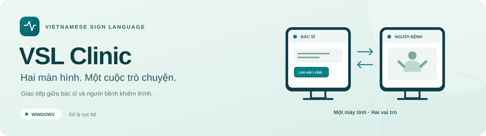
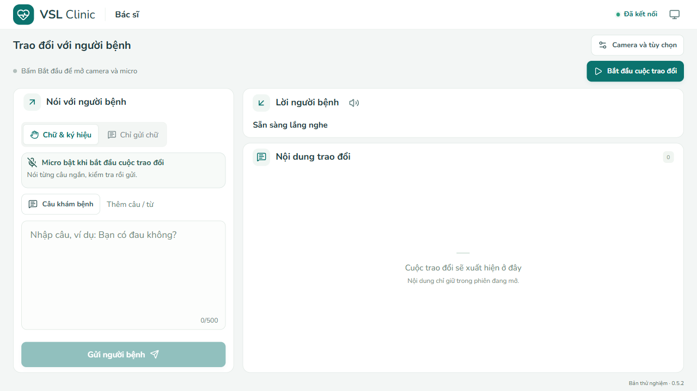
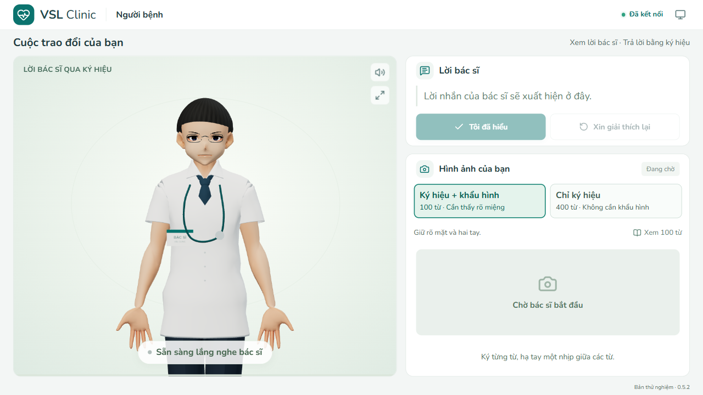
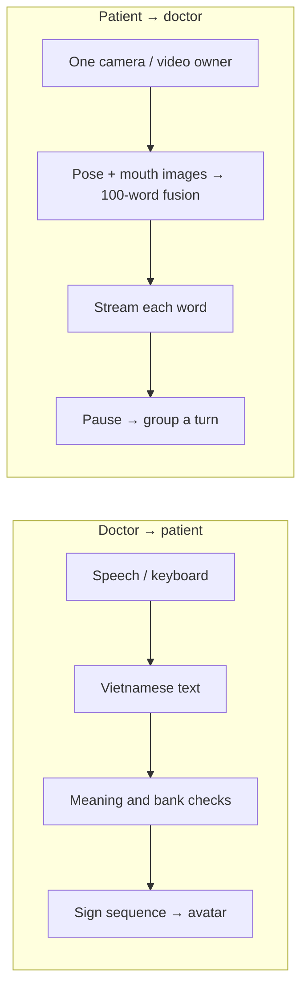

<p align="center">
  
</p>

<p align="center">
  <strong>A shared communication space for doctors and deaf patients.</strong><br>
  Vietnamese Sign Language · Local desktop communication
</p>

<p align="center">
  
  
  
</p>

<p align="center">
  <a href="#interface">Interface</a> ·
  <a href="#getting-started">Getting started</a> ·
  <a href="#how-it-works">Architecture</a> ·
  <a href="docs/README.md">Documentation</a>
</p>

---

**VSL Clinic** runs on one Windows computer with two simultaneous windows. Doctors speak Vietnamese or type; patients see the message and a signing avatar. In the other direction, recognized sign words appear immediately and are read aloud on the doctor's screen, then form a conversation turn after a pause.

Version **0.5.2** defaults to **Ký hiệu + khẩu hình · 100 words** (fusion) and offers **Chỉ ký hiệu · 400 words** on the patient screen. The active dictionary, label namespace, offline readout and sample selection switch together in both windows. The minimal Vietnamese interface puts setup in **Camera và tùy chọn**, and the doctor has 24 quick clinical phrases beside the composer plus stronger silence rejection. Each clear completed word still appears and is spoken before turn grouping. The app manages the bundled models and runtimes automatically. [Usage, measured checks and pilot limits](docs/CLINIC_0.5.2.md). The original 0.4.1 portable folder/launcher, research sources and verification evidence remain preserved. The owner approved cleanup of nine obsolete release folders after installer validation. Verification uses prerecorded fixtures; live webcam/room-noise robustness is unverified. This is a non-commercial research demo under the bundled AV-HuBERT license.

Version 0.3.5 bundles Vietnamese readout audio for all 400 recognition labels. Playback is offline, uses a slightly slower pace with pitch preserved, and never repeats the completed sentence. The doctor microphone pauses during readout and resumes after the room-echo guard; a microphone manually muted by the doctor stays muted. The speaker button beside the live patient words turns readout on or off. Text is larger on both 16:9 screens. [Readout and packaging notes](docs/PATIENT_VOICE_0.3.5.md).

Version 0.3.7 gives conversation history two thirds of the doctor's workspace, collapses pending speech into a compact review panel and shows the patient's avatar progress on the doctor's screen. Ending clears both screens; an optional temporary copy stays read-only in memory. [Workspace behavior and validation](docs/WORKSPACE_0.3.7.md).

| Patient-side recognition | Avatar motion bank | Controlled templates | Setup |
| :---: | :---: | :---: | :---: |
| **100** multimodal labels | **67** signs | **65** sentence patterns | **1 computer · 2 screens** |

This is a demo with a defined vocabulary. Recognition labels and avatar motions are separate inventories. Equal names across the new 100 and retained 400 labels are lexical candidates, not proven equivalent signing motions.

## Interface

<table>
  <tr>
    <td width="50%"><strong>Doctor screen</strong><br>Speak or type, watch incoming words, and follow the conversation history.</td>
    <td width="50%"><strong>Patient screen</strong><br>View the signing avatar, the doctor's message, and a camera preview.</td>
  </tr>
  <tr>
    <td><a href="docs/evidence/clinic-052-minimal-doctor-1280.png"></a></td>
    <td><a href="docs/evidence/clinic-052-minimal-patient-1280.png"></a></td>
  </tr>
</table>

<sub>Actual packaged 0.5.2 screenshots in the idle state, captured during the final fixture UI check. The app interface and supported speech language are Vietnamese. Click an image to enlarge. [Verification and limits](docs/CLINIC_0.5.2.md).</sub>

### Two directions, one conversation

| Patient → doctor | Doctor → patient |
| --- | --- |
| Camera or video captures movement. | Vietnamese microphone input or typed text. |
| Each recognized word is sent immediately. | Reviewed aliases, meaning checks and sign coverage are evaluated. |
| A longer pause groups words into a turn; original labels remain available. | The avatar plays a sign sequence on a shared text/motion timeline. |

**Automatic mode:** a speech pause ends an utterance; clearly recognized, supported content is sent immediately. **Review before sending:** the doctor checks, edits and sends each utterance. Unsupported meaning stays in a draft for rephrasing or an explicit text-only send.

## Getting started

For source development, use **Windows, Python 3.11 and Node.js 22+**. The reference machine used for testing has an i7-10750H, 16 GB RAM and GTX 1650 Ti 4 GB; this is not a measured minimum specification.

```powershell
git clone https://github.com/ntthienphuc/vsl-clinic-desktop.git
cd vsl-clinic-desktop

# Replace this with a complete Clinic copy you are authorized to use.
py -3.11 tools/restore_local_assets.py --from "D:\complete-copy\vsl-clinic-desktop"

./tools/setup.ps1
npm start
```

> [!IMPORTANT]
> Git includes source, the motion bank, avatar assets and documentation. **Recognition/speech weights, original videos and the executable are not in this repository.** The current restore manifest verifies 21,179 local asset/runtime files using SHA-256; it does not download them. See the [source and local-assets guide](docs/GIT_SETUP.md).

For end users, the local **VSL-Clinic-Setup-0.5.2.exe** installs all models and runtimes and creates **VSL Clinic** on the Desktop. Python, Node and a separate model server are not needed. The installer is a local artifact and is not uploaded to this repository. Developers can still use the complete portable folder. See [package contents](docs/PACKAGE_CONTENTS.md) and [installer build instructions](installer/README.md).

### Start a conversation

1. **The doctor selects a camera/video source** and Automatic or Review mode, then presses **Bắt đầu cuộc trao đổi** (Start conversation).
2. **The doctor speaks or types one short idea.** The patient sees the message and signing avatar on their screen.
3. **The patient signs individual words**, pausing approximately 0.7–1 second between words and 1.5 seconds after a turn. Each word appears immediately for the doctor.

One monitor can display the windows side by side. With two monitors, **Bố trí màn hình** (Screen layout) can arrange or swap them. [Full usage guide →](docs/USAGE.md)

## How it works



| Component | Technology |
| --- | --- |
| Desktop shell and two windows | Electron · React · TypeScript · Vite |
| Avatar and hand motion | Three.js · VRM · inverse kinematics · joint constraints |
| Engine and synchronization | Python · FastAPI · loopback WebSocket |
| Sign recognition | MediaPipe Pose/Hands · SL-GCN through ONNX Runtime |
| Vietnamese speech | PhoWhisper INT8 · Silero VAD · local inference |

The runtime uses reviewed sentence templates and aliases, not a free-form generative LLM. Original content is preserved; symptoms, negation, quantities and diagnoses are not invented. [Semantic routing and bank design, Vietnamese →](docs/SEMANTIC_AND_BANK_PLAN.md)

<details>
<summary><strong>Repository layout</strong></summary>

```text
vsl-clinic-desktop/
├── src/         Doctor/patient interfaces, avatar and client state
├── desktop/     Electron windows and engine lifecycle
├── backend/     Recognition, ASR, planning and conversation state
├── assets/      Catalogs, motion bank and avatar assets
├── demo/        Scripts, manifests and practice instructions
├── tests/       Backend and avatar kinematics checks
├── tools/       Setup, data processing, audits and packaging
├── docs/        Guides, design notes and verification evidence
└── licenses/    Third-party notices and license texts
```

This standalone desktop repository contains neither the Android/Flutter app nor the Translator repository's Git history.

</details>

## Verification and scope

| Recorded check | Result | Evidence |
| --- | --- | --- |
| Independent checkout · 2026-11-01 | **303 Python tests**, **6 avatar tests**, frontend build passed | [Source check](docs/evidence/standalone-source-check-2026-11-01.json) |
| Portable inventory · 2026-11-01 | **1,990 payload files** matched the receipt; models, avatar and motions present | [Package inventory](docs/evidence/portable-inventory-2026-11-01.json) |
| Relocated frozen engine · 2026-11-01 | Recognition and PhoWhisper ran with an empty model cache; **93 videos** decoded | [Runtime probe](docs/evidence/portable-runtime-2026-11-01.json) |
| Fixed reference-video checks, repeated twice · 2026-10-31 | **20/20 turns**, **28/28 word occurrences** in the expected order | [Rehearsal retest](docs/evidence/idle-retest-summary-2026-10-31.json) |

The rehearsal repeats the same 14 word occurrences after reducing machine load; these are not 28 independent samples or a 400-class accuracy benchmark. Earlier loaded-machine runs included errors. Relocation was tested on the same Windows PC, not a clean Windows VM. [Conditions and limitations, Vietnamese →](docs/DEMO_0.3.4.md)

The recognizer handles **isolated words** and requires word boundaries. Continuous signing, new speakers/signers, avatar comprehension by VSL users and clinical conversations have not been fully validated. Demo patterns are not labeled as a verified Đồng Nai regional standard.

<details>
<summary><strong>Run checks and build a portable distribution</strong></summary>

After restoring local inputs and completing setup:

```powershell
.venv/Scripts/python.exe -m pytest -q
npm test
npm run build
```

Close any app using the output folder before packaging:

```powershell
.venv/Scripts/python.exe tools/build_demo_kit.py
./tools/build.ps1
```

The build checks backend behavior, kinematics, the VRM rig, notices and payload SHA-256 hashes. Keep the complete portable folder together. The Windows executable is currently unsigned.

</details>

## Documentation

| I want to… | Start here |
| --- | --- |
| Set up source and recover local inputs | [Source & local assets](docs/GIT_SETUP.md) |
| Use the two-screen app | [Usage guide](docs/USAGE.md) |
| Check the end-user distribution | [Windows package contents](docs/PACKAGE_CONTENTS.md) |
| Understand language coverage | [Semantic routing, Vietnamese](docs/SEMANTIC_AND_BANK_PLAN.md) |
| Understand motion smoothing | [Motion quality, Vietnamese](docs/MOTION_QUALITY.md) |
| Browse all guides and evidence | [Documentation index](docs/README.md) |

---

<p align="center">
  <strong>VSL Clinic</strong> · Two screens. One conversation.<br>
  <a href="THIRD_PARTY_NOTICES.md">Asset sources & licenses</a> ·
  <a href="https://github.com/ntthienphuc/vsl-clinic-desktop/issues">Report an issue / suggest an improvement</a>
</p>
