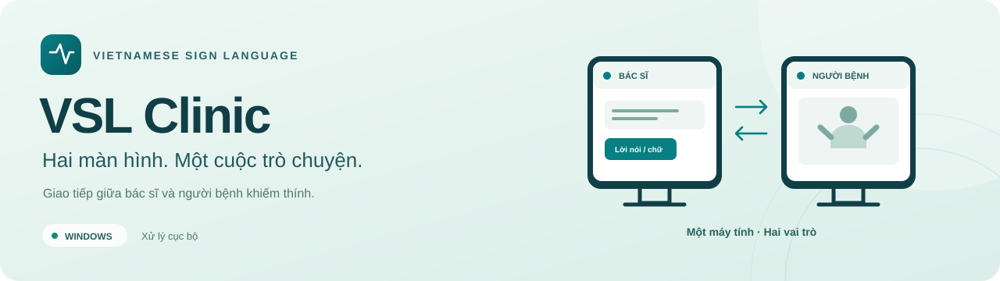
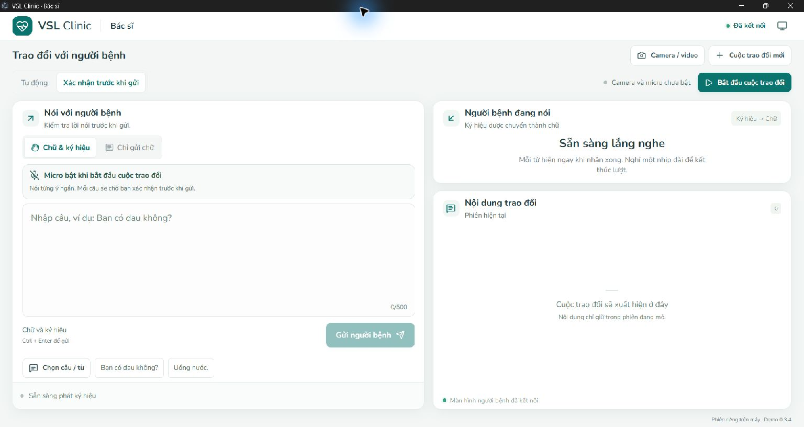
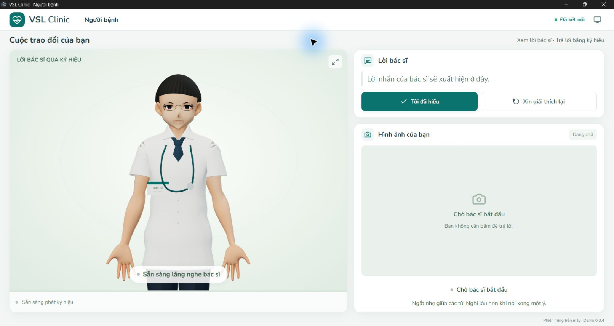
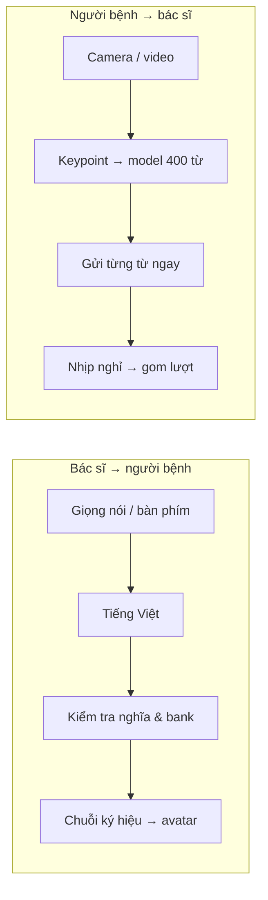

<p align="center">
  
</p>

<p align="center">
  <strong>Không gian giao tiếp giữa bác sĩ và người bệnh khiếm thính.</strong><br>
  Vietnamese Sign Language · Local desktop communication
</p>

<p align="center">
  
  
  
</p>

<p align="center">
  <a href="#giao-diện">Giao diện</a> ·
  <a href="#chạy-trên-máy">Cách chạy</a> ·
  <a href="#hai-kịch-bản-demo">Demo</a> ·
  <a href="#bên-trong-clinic">Kiến trúc</a> ·
  <a href="docs/README.md">Tài liệu</a>
</p>

---

**VSL Clinic** chạy trên một máy Windows, mở hai cửa sổ song song cho hai vai trò. Bác sĩ nói tiếng Việt hoặc nhập chữ; người bệnh xem lời nhắn và avatar ký hiệu. Ở chiều ngược lại, mỗi từ ký hiệu nhận được sẽ xuất hiện ngay trước khi được gom thành lượt hội thoại.

| Nhận dạng phía người bệnh | Bank phát avatar | Mẫu câu có kiểm soát | Bố trí |
| :---: | :---: | :---: | :---: |
| **400** nhãn từ rời | **65** ký hiệu | **58** mẫu câu | **1 máy · 2 màn hình** |

Đây là bản demo có phạm vi từ vựng rõ ràng. Hai chiều nhận dạng và phát avatar dùng hai tập dữ liệu khác nhau; 400 nhãn nhận dạng không đồng nghĩa với 400 ký hiệu avatar.

## Giao diện

<table>
  <tr>
    <td width="50%"><strong>Màn hình bác sĩ</strong><br>Nói hoặc nhập chữ, xem từng từ đang nhận và theo dõi lịch sử trao đổi.</td>
    <td width="50%"><strong>Màn hình người bệnh</strong><br>Xem avatar, lời bác sĩ và preview camera trong một bố cục đơn giản.</td>
  </tr>
  <tr>
    <td><a href="docs/media/doctor-screen.png"></a></td>
    <td><a href="docs/media/patient-screen.png"></a></td>
  </tr>
</table>

<sub>Ảnh chụp thật bản Windows 0.3.4 ở trạng thái chờ. Bấm vào ảnh để xem lớn. [Nguồn ảnh](docs/media/README.md).</sub>

### Hai chiều, một cuộc trao đổi

| Người bệnh → bác sĩ | Bác sĩ → người bệnh |
| --- | --- |
| Camera hoặc video quan sát chuyển động. | Micro tiếng Việt hoặc nhập trực tiếp. |
| Nhận dạng từng từ và gửi ngay sang màn hình bác sĩ. | Kiểm tra câu, từ đồng nghĩa đã duyệt và độ phủ ký hiệu. |
| Nghỉ một nhịp dài để gom thành lượt; giữ lại từ gốc. | Phát chuỗi ký hiệu trên avatar, đồng bộ cùng chữ. |

**Tự động:** một nhịp nghỉ kết thúc ý nói; câu nhận rõ và đủ ký hiệu được gửi ngay. **Xác nhận trước khi gửi:** bác sĩ đọc, sửa và gửi từng câu. Nội dung chưa đủ nghĩa sẽ được giữ để nói lại hoặc chủ động gửi bằng chữ.

## Chạy trên máy

Cần **Windows, Python 3.11 và Node.js 22+**. Máy đã dùng kiểm thử: i7-10750H, RAM 16 GB, GTX 1650 Ti 4 GB; đây là cấu hình tham chiếu, chưa phải yêu cầu tối thiểu đã đo.

```powershell
git clone https://github.com/ntthienphuc/vsl-clinic-desktop.git
cd vsl-clinic-desktop

# Thay đường dẫn bằng bộ Clinic đầy đủ mà bạn được phép sử dụng.
py -3.11 tools/restore_local_assets.py --from "D:\ban-sao-day-du\vsl-clinic-desktop"

./tools/setup.ps1
npm start
```

> [!IMPORTANT]
> Git chứa mã nguồn, bank chuyển động, avatar và tài liệu. **Model nhận dạng/giọng nói, video gốc và EXE không nằm trong repo.** Lệnh khôi phục kiểm tra 107 file theo SHA-256; không tự tải dữ liệu. Nếu chưa có bộ đầu vào, xem [hướng dẫn checkout và dữ liệu](docs/GIT_SETUP.md).

Đã có bản portable? Mở `VSL Clinic.exe` trong cả thư mục `win-unpacked`, không cần cài Python/Node. Hướng dẫn nằm ở [bàn giao 0.3.4](docs/DEMO_0.3.4.md).

### Bắt đầu trong ba bước

1. **Bác sĩ chọn nguồn hình ảnh** và chế độ Tự động hoặc Xác nhận trước khi gửi, rồi bấm **Bắt đầu cuộc trao đổi**.
2. **Bác sĩ nói hoặc nhập từng ý ngắn.** Người bệnh xem avatar và lời nhắn trên màn hình riêng.
3. **Người bệnh ký từng từ**, nghỉ khoảng 0,7–1 giây giữa các từ và khoảng 1,5 giây sau một lượt. Mỗi từ hiện ngay phía bác sĩ.

Một màn hình có thể chia đôi hai cửa sổ. Với hai màn hình, dùng menu **Bố trí màn hình** để sắp xếp hoặc đổi bên. [Xem hướng dẫn thao tác đầy đủ →](docs/USAGE.md)

## Hai kịch bản demo

Hai kịch bản có sẵn trong app tại **Chọn câu / từ → 2 kịch bản demo**. Mỗi kịch bản gồm 5 lượt, kèm lời bác sĩ, thứ tự ký hiệu của người bệnh và hướng dẫn video.

| Kịch bản | Nội dung | Hướng dẫn |
| --- | --- | --- |
| **01 · Tiếp đón và hỏi triệu chứng** | Khám bệnh, đau, mệt, đo nhiệt độ, nghỉ ngơi. | [Mở kịch bản](demo/HAI_KICH_BAN_2026-10-31/01_Tiep_don_va_hoi_trieu_chung/KICH_BAN.md) |
| **02 · Nêu nhu cầu và hỗ trợ** | Cần giúp đỡ, cần nước, đồng ý, cần nghỉ, cảm ơn. | [Mở kịch bản](demo/HAI_KICH_BAN_2026-10-31/02_Nhu_cau_va_ho_tro/KICH_BAN.md) |

Chưa có webcam vẫn có thể thử bằng video sau khi khôi phục dữ liệu. App chạy nhận dạng trên video thật, không gán sẵn đáp án. [Chuẩn bị demo và cách dùng clip →](demo/HAI_KICH_BAN_2026-10-31/README.md)

## Bên trong Clinic



| Thành phần | Công nghệ |
| --- | --- |
| Ứng dụng và hai cửa sổ | Electron · React · TypeScript · Vite |
| Avatar và chuyển động bàn tay | Three.js · VRM · IK · giới hạn khớp |
| Engine và đồng bộ | Python · FastAPI · WebSocket trên loopback |
| Nhận dạng ký hiệu | MediaPipe Pose/Hands · SL-GCN qua ONNX Runtime |
| Nhận tiếng Việt | PhoWhisper INT8 · Silero VAD · xử lý cục bộ |

Runtime chọn mẫu câu và alias đã duyệt; chưa có LLM sinh bản dịch tự do. Giữ nguyên nội dung gốc, không tự thêm triệu chứng, phủ định, liều lượng hoặc chẩn đoán. [Cơ chế ngôn ngữ và bank →](docs/SEMANTIC_AND_BANK_PLAN.md)

<details>
<summary><strong>Cấu trúc mã nguồn</strong></summary>

```text
vsl-clinic-desktop/
├── src/         Hai giao diện, avatar và trạng thái phía client
├── desktop/     Electron, cửa sổ và vòng đời engine
├── backend/     Nhận dạng, ASR, planner và hội thoại
├── assets/      Catalog, bank chuyển động và avatar
├── demo/        Kịch bản, manifest và hướng dẫn tập
├── tests/       Kiểm thử backend và động học avatar
├── tools/       Setup, xử lý dữ liệu, audit và đóng gói
├── docs/        Hướng dẫn, thiết kế và bằng chứng kiểm thử
└── licenses/    Thông tin giấy phép các thành phần
```

Repo độc lập cho desktop; mã Android/Flutter và lịch sử dự án Translator không nằm trong repo này.

</details>

## Kiểm thử và phạm vi

| Phép kiểm tra đã lưu | Kết quả | Bằng chứng |
| --- | --- | --- |
| Checkout độc lập · 01/11/2026 | **303 test Python**, **6 test avatar**, build giao diện đạt | [Source check](docs/evidence/standalone-source-check-2026-11-01.json) |
| Hai kịch bản video, lặp hai vòng · 31/10/2026 | **20/20 lượt**, **28/28 lần nhận từ** đúng thứ tự | [Runtime retest](docs/evidence/idle-retest-summary-2026-10-31.json) |

Phép thử video lặp lại cùng 14 lượt nhận từ sau khi máy giảm tải; không phải 28 mẫu độc lập hoặc đánh giá toàn bộ 400 nhãn. Khi máy bận đã có nhận sai. [Điều kiện đo và giới hạn →](docs/DEMO_0.3.4.md)

Model hiện nhận **từ rời**, cần nhịp nghỉ giữa các từ. Ký liền thành câu, giọng/người ký mới, mức hiểu avatar của người dùng VSL và hội thoại lâm sàng chưa được kiểm chứng đầy đủ. Các mẫu câu demo không được gắn nhãn chuẩn riêng cho hệ Đồng Nai.

<details>
<summary><strong>Chạy kiểm thử và đóng gói</strong></summary>

Sau khi khôi phục đầu vào và chạy setup:

```powershell
.venv/Scripts/python.exe -m pytest -q
npm test
npm run build
```

Đóng app đang dùng thư mục đầu ra trước khi đóng gói:

```powershell
.venv/Scripts/python.exe tools/build_demo_kit.py
./tools/build.ps1
```

Build kiểm tra backend, động học, rig VRM, giấy phép và SHA-256 payload trước khi bàn giao. Giữ cả thư mục portable; bản Windows hiện chưa có chứng thư ký mã.

</details>

## Tài liệu

| Bạn muốn… | Mở tài liệu |
| --- | --- |
| Cài và khôi phục đầu vào | [Git & local assets](docs/GIT_SETUP.md) |
| Thao tác hai màn hình | [Hướng dẫn sử dụng](docs/USAGE.md) |
| Chuẩn bị buổi trình diễn | [Hai kịch bản demo](demo/HAI_KICH_BAN_2026-10-31/README.md) |
| Hiểu cách xử lý câu và từ ngoài bank | [Semantic routing](docs/SEMANTIC_AND_BANK_PLAN.md) |
| Hiểu cách làm mượt và giới hạn khớp | [Motion quality](docs/MOTION_QUALITY.md) |
| Xem toàn bộ tài liệu và bằng chứng | [Mục lục tài liệu](docs/README.md) |

---

<p align="center">
  <strong>VSL Clinic</strong> · Hai màn hình. Một cuộc trò chuyện.<br>
  <a href="THIRD_PARTY_NOTICES.md">Nguồn tài nguyên & giấy phép</a> ·
  <a href="https://github.com/ntthienphuc/vsl-clinic-desktop/issues">Báo lỗi / góp ý</a>
</p>
