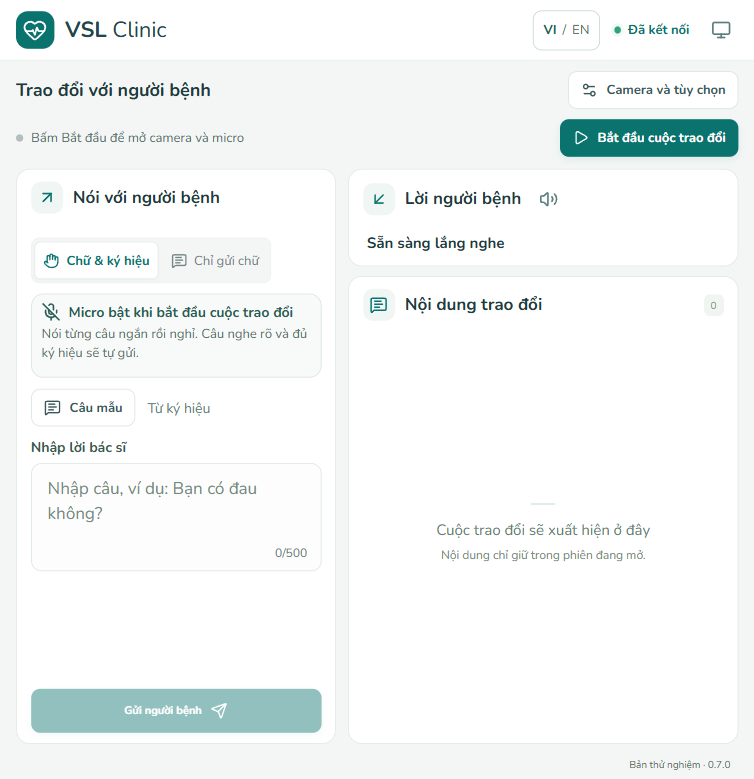
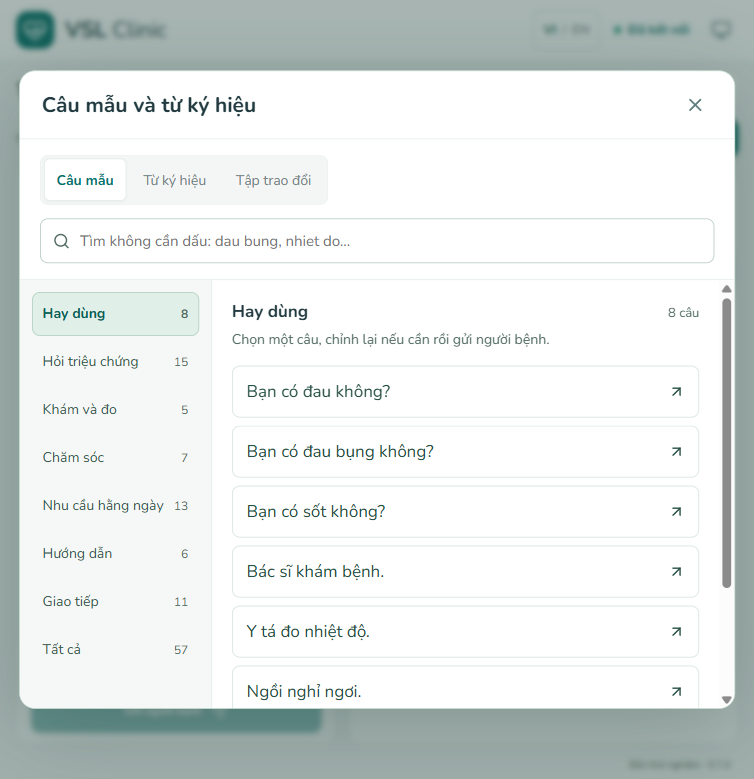

# VSL Clinic 0.7.5 · 20/11/2026

Ba câu gửi nhanh nằm ngay phía trên ô soạn. Nút Câu mẫu mở thư viện theo tình huống. Tab Từ điển ký hiệu dành riêng cho tra từ và xem động tác.

Bản đánh giá nội bộ dùng SL-GCN và nhánh hình ảnh Auto-AVSR với cross-attention. Mô hình mặc định nhận 100 từ qua tay và khẩu hình. Bác sĩ có thể chọn Chỉ ký hiệu (400 từ) trong Tùy chọn. Avatar có 200 mục. CPU lượng tử hóa động 48 lớp truyền thẳng của Conformer; GPU dùng FP32.

Bấm Bắt đầu ở màn hình bác sĩ. Chọn câu mẫu để gửi ngay, hoặc nói hay nhập câu. Khi camera lỗi, có thể tiếp tục trao đổi bằng chữ và câu mẫu. Người bệnh xem avatar và ký trước camera. Bấm Kết thúc trước khi tiếp người tiếp theo.

Trọng số môi được tách từ bản VLR có SHA-256 b38177ae98f1f3cbea1a4c183c2bca804cf0a576e99abd23aab85ae56f413280. Apache-2.0 áp dụng cho mã Auto-AVSR. Quyền phân phối trọng số và phạm vi sử dụng tại BV175 cần được xác nhận riêng. Tài liệu nhà phát triển: https://github.com/mpc001/auto_avsr#license . Các mục bên dưới lưu thông tin các phiên bản trước.

# VSL Clinic 0.7.4 · 20/11/2026

Ứng viên đánh giá cục bộ. Giữ 100 nhãn tay + khẩu hình, 400 nhãn chỉ ký hiệu và 200 chuyển động avatar. Bổ sung câu gọi người thân và mời viết. Khi Windows không mở được dịch vụ, hộp thoại có nút **Xem tệp chẩn đoán**. Gửi `clinic-startup.json` cho kỹ thuật viên để đối chiếu máy, phiên bản, đường dẫn và lỗi hệ thống.

Kết thúc phiên trong lúc mở camera hủy lần bắt đầu đang chờ. Bản sao video nhập vào được giải phóng khi dừng hoặc kết thúc phiên. Bộ cài yêu cầu thư mục trống hoặc bản Clinic đã cài. Kết quả kiểm và phạm vi sử dụng ghi ở `../Organization/Readiness074_2026-11-20`.

AV-HuBERT có giới hạn nghiên cứu phi thương mại và hạn chế cụ thể ở mục 2(a), gồm sử dụng trong sản xuất/vận hành và mục đích quân sự. Trước khi dùng tại BV175, cần làm rõ quyền sử dụng theo mục đích, đơn vị và bối cảnh dự kiến hoặc thay thành phần rồi đánh giá lại. Chưa nghiệm thu lâm sàng.

# Cập nhật 0.7.3 — 16/11/2026

Bộ cài R2 bỏ trang chấp thuận giấy phép và trang thông tin trước cài. Tài liệu Word giấy phép được cung cấp riêng và cài trong `Tai_lieu`. Hướng dẫn thao tác được viết lại ngắn, dễ làm theo. Mã ứng dụng, model và các luồng giao tiếp giữ nguyên 0.7.3. Biên nhận cập nhật được chốt tại `../Organization/GuideSimpleSetup_2026-11-16/FINAL_ACCEPTANCE.json` sau khi kiểm bản cài.

Kết quả người bệnh phía bác sĩ: top 1 xanh, top 2 và 3 vàng, cùng cỡ chữ 23 px và cùng độ đậm để đối chiếu ngữ cảnh. Nội dung được đọc vẫn là top 1. Hồ sơ đề xuất v4 định hướng thí điểm, phát triển phiên bản nâng cao và triển khai thực tế; có danh mục 200 từ avatar.

Trạng thái các lượt kiểm phát hành được ghi tại Organization/Revision073_2026-11-16. Phần dưới là hồ sơ phiên bản trước để đối chiếu.

# VSL Clinic 0.7.2

**Bản 0.7.2:** hai luồng trao đổi chạy song song; câu bác sĩ mới ngắt câu đang phát; câu mẫu bấm là gửi; kho 200 từ có xem trước; sửa khuỷu tay xoắn, tay áo và các ngón tay đã đối chiếu nguồn. Xem [trạng thái và bằng chứng](PROJECT_STATE.md).

Ứng dụng Windows giúp bác sĩ và người bệnh khiếm thính trao đổi qua hai cửa sổ: lời nói/chữ → avatar ký hiệu; ký hiệu người bệnh → chữ và giọng đọc từng từ.

**Một bộ cài offline:** `../Installer/VSL-Clinic-Setup-0.7.2.exe`. Không cần cài Python, Node.js, CUDA Toolkit hay mở model server. Bộ cài cho chọn **GPU NVIDIA** hoặc **CPU**; phát hiện NVIDIA thì chọn sẵn GPU. Chế độ GPU vẫn có CPU dự phòng khi driver không chạy được. Máy cần Windows 10 2004+/11 x64, CPU AVX2; RAM 16 GB là cấu hình tham khảo đã dùng, chưa phải minimum được đo. Trạng thái kiểm bản cài được chốt trong biên nhận ở [PROJECT_STATE](PROJECT_STATE.md).

## Dùng ứng dụng

1. Cài đặt rồi mở **VSL Clinic** trên Desktop. Bác sĩ dùng **Camera và tùy chọn** để chọn camera và cách nhận ký hiệu.
2. Bấm **Bắt đầu cuộc trao đổi**. Nói câu ngắn, gõ chữ hoặc chọn **Câu mẫu**. Lời nói rõ và có đủ ký hiệu tự gửi; ý chưa thể hiện đầy đủ giữ lại để sửa hoặc gửi nguyên văn bằng chữ.
3. Người bệnh có thể ký trước camera ngay cả khi avatar đang chạy. Từ đứng đầu hiện và được đọc ngay, không beep, không chờ xác nhận. Phía bác sĩ thấy thêm hai phương án kế tiếp nếu có; micro bác sĩ tiếp tục nghe.
4. Bấm **Kết thúc** để dừng camera, micro, avatar và âm thanh, dọn nội dung cả hai màn hình. Bản lưu tạm chỉ nằm trong bộ nhớ nếu bác sĩ chủ động chọn.

[Hướng dẫn đầy đủ](docs/USAGE.md) · [Trạng thái và giới hạn](PROJECT_STATE.md) · [Tài liệu kỹ thuật/lịch sử](docs/README.md)

## Giao diện hiện tại

Màn hình người bệnh **chỉ hiển thị**, không có nút bấm hoặc tên model. Bác sĩ quản lý thiết bị, chế độ, ngôn ngữ và bố trí cửa sổ. **VI / EN** đổi giao diện cả hai màn hình; câu trao đổi, ký hiệu và giọng đọc giữ tiếng Việt.





Hai ảnh trên minh họa bố cục ở checkpoint trước. Ảnh avatar 0.7.2 và kiểm giao diện hiện hành được dẫn trong [trạng thái](PROJECT_STATE.md). [Audit](UI_UX_AUDIT.md) · [Thay đổi và kết quả kiểm tra](UI_UX_POLISH_REPORT.md).

| Thành phần | Phạm vi hiện tại |
| --- | --- |
| Người bệnh — Ký hiệu + khẩu hình (mặc định) | 100 nhãn, hình tay/thân và vùng miệng; CPU INT8 hoặc GPU FP32 |
| Người bệnh — Chỉ ký hiệu | 400 nhãn cũ; chọn trong cài đặt bác sĩ |
| Avatar bác sĩ | 200 từ có chuyển động, 265 mục giọng đọc; kho xem trước/tìm không dấu |
| Câu mẫu bác sĩ | 57 câu, 8 câu thường dùng khi mở, 6 nhóm công việc; tìm không dấu |
| Lời bác sĩ | Quy tắc nghĩa, mẫu câu và các thành phần ngôn ngữ cục bộ; giữ câu gốc, phủ định và ý chưa hỗ trợ |

Kho avatar và nhãn nhận dạng là hai bộ riêng. Thêm từ cho avatar không tự mở rộng model người bệnh. 96 từ bổ sung từ mốc 104 lấy từ VSL400 địa phương, ba người ký/từ, có nguồn/hashes. Không có video QIPEDC mới được tải trong vòng này. Runtime lưu chuyển động nén khoảng 6,31 MiB thay cho khoảng 68,82 MiB JSON; video nguồn mới không đóng vào app. Đây là giảm phần chuyển động, không phải mức giảm tổng bộ cài.

## Source và đóng gói

Source dùng React/TypeScript, Electron, Three.js/VRM và Python/FastAPI cục bộ. Git chứa code, chuyển động, avatar và tài liệu; không chứa toàn bộ trọng số, runtime hoặc EXE. Phục hồi các tài sản được phép bằng `local-assets-manifest.json` theo [GIT_SETUP](docs/GIT_SETUP.md), sau đó:

```powershell
./tools/setup.ps1
npm start
npm test
.venv/Scripts/python.exe -m pytest
npm run package
.venv/Scripts/python.exe tools/release_receipt.py
npm run installer
```

[Đóng gói offline](installer/README.md). `BUILD_RECEIPT.json` đối chiếu payload với source. Kiểm cài đặt, runtime, shortcut và dọn bản cũ có receipt riêng tại `../Organization/AvatarReview_2026-11-15/ACCEPTANCE.json`; chỉ receipt có `passed: true` mới xác nhận bàn giao cài đặt. Không có tự push, upload hoặc deploy.

Baseline 0.7.0: tag `baseline/clinic-0.7.0-before-minimal-redesign`; bộ cài quay lui được giữ riêng. Lịch sử source và nguồn nghiên cứu được bảo toàn; không khẳng định các EXE lịch sử đã dọn từ đợt trước còn tồn tại.

## Giới hạn

Đây là bản ứng dụng đã kiểm kỹ thuật bằng fixture và tình huống giả lập, chưa được đánh giá người ký trực tiếp, tiếng ồn phòng khám, độ dễ hiểu VSL theo vùng hoặc máy sạch độc lập. Không thay phiên dịch viên/chẩn đoán. Phiên bản này không training hoặc đổi trọng số nhận dạng. CPU/GPU nói tới Windows x64/NVIDIA; Jetson/Raspberry Pi chưa được hỗ trợ. AV-HuBERT đi kèm giấy phép nghiên cứu phi thương mại; xem [THIRD_PARTY_NOTICES](THIRD_PARTY_NOTICES.md) trước khi triển khai ngoài phạm vi được phép.
