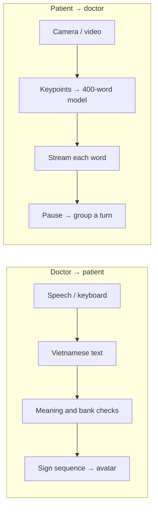

<p align="center">
  
</p>

<p align="center">
  <strong>A shared communication space for doctors and deaf patients.</strong><br>
  Vietnamese Sign Language · Local desktop communication
</p>

<p align="center">
  
  
  
</p>

<p align="center">
  <a href="#interface">Interface</a> ·
  <a href="#getting-started">Getting started</a> ·
  <a href="#demo-scenarios">Demo</a> ·
  <a href="#how-it-works">Architecture</a> ·
  <a href="docs/README.md">Documentation</a>
</p>

---

**VSL Clinic** runs on one Windows computer with two simultaneous windows. Doctors speak Vietnamese or type; patients see the message and a signing avatar. In the other direction, recognized sign words appear immediately on the doctor's screen, then form a conversation turn after a pause.

| Patient-side recognition | Avatar motion bank | Controlled templates | Setup |
| :---: | :---: | :---: | :---: |
| **400** isolated-word labels | **65** signs | **58** sentence patterns | **1 computer · 2 screens** |

This is a demo with a defined vocabulary. Recognition labels and avatar motions are separate inventories: 400 recognition labels do not mean 400 avatar signs.

## Interface

<table>
  <tr>
    <td width="50%"><strong>Doctor screen</strong><br>Speak or type, watch incoming words, and follow the conversation history.</td>
    <td width="50%"><strong>Patient screen</strong><br>View the signing avatar, the doctor's message, and a camera preview.</td>
  </tr>
  <tr>
    <td><a href="docs/media/doctor-screen.png"></a></td>
    <td><a href="docs/media/patient-screen.png"></a></td>
  </tr>
</table>

<sub>Actual Windows 0.3.4 screenshots in the idle state. The app interface and supported speech language are Vietnamese. Click an image to enlarge. [Image provenance](docs/media/README.md).</sub>

### Two directions, one conversation

| Patient → doctor | Doctor → patient |
| --- | --- |
| Camera or video captures movement. | Vietnamese microphone input or typed text. |
| Each recognized word is sent immediately. | Reviewed aliases, meaning checks and sign coverage are evaluated. |
| A longer pause groups words into a turn; original labels remain available. | The avatar plays a sign sequence on a shared text/motion timeline. |

**Automatic mode:** a speech pause ends an utterance; clearly recognized, supported content is sent immediately. **Review before sending:** the doctor checks, edits and sends each utterance. Unsupported meaning stays in a draft for rephrasing or an explicit text-only send.

## Getting started

For source development, use **Windows, Python 3.11 and Node.js 22+**. The reference machine used for testing has an i7-10750H, 16 GB RAM and GTX 1650 Ti 4 GB; this is not a measured minimum specification.

```powershell
git clone https://github.com/ntthienphuc/vsl-clinic-desktop.git
cd vsl-clinic-desktop

# Replace this with a complete Clinic copy you are authorized to use.
py -3.11 tools/restore_local_assets.py --from "D:\complete-copy\vsl-clinic-desktop"

./tools/setup.ps1
npm start
```

> [!IMPORTANT]
> Git includes source, the motion bank, avatar assets and documentation. **Recognition/speech weights, original videos and the executable are not in this repository.** The restore tool verifies 107 local inputs using SHA-256; it does not download them. See the [source and local-assets guide](docs/GIT_SETUP.md).

Already have the portable distribution? Keep its entire folder together and open `VSL Clinic.exe`. It includes its own runtimes; installing Python or Node is not part of the end-user workflow. This is a portable folder, not a single-file EXE or installer. See [what the Windows package includes](docs/PACKAGE_CONTENTS.md).

### Start a conversation

1. **The doctor selects a camera/video source** and Automatic or Review mode, then presses **Bắt đầu cuộc trao đổi** (Start conversation).
2. **The doctor speaks or types one short idea.** The patient sees the message and signing avatar on their screen.
3. **The patient signs individual words**, pausing approximately 0.7–1 second between words and 1.5 seconds after a turn. Each word appears immediately for the doctor.

One monitor can display the windows side by side. With two monitors, **Bố trí màn hình** (Screen layout) can arrange or swap them. [Full usage guide →](docs/USAGE.md)

## Demo scenarios

Both scenarios are available in **Chọn câu / từ → 2 kịch bản demo** (Choose phrase/word → 2 demo scenarios). Each contains five turns with exact Vietnamese doctor prompts, patient sign order and practice-video instructions.

| Scenario | Conversation | Script |
| --- | --- | --- |
| **01 · Reception and symptoms** | Examination, pain, tiredness, temperature measurement and rest. | [Vietnamese script](demo/HAI_KICH_BAN_2026-10-31/01_Tiep_don_va_hoi_trieu_chung/KICH_BAN.md) |
| **02 · Needs and assistance** | Asking for help or water, agreement, rest and thanks. | [Vietnamese script](demo/HAI_KICH_BAN_2026-10-31/02_Nhu_cau_va_ho_tro/KICH_BAN.md) |

After restoring local inputs, you can rehearse with video instead of a webcam. The app runs real recognition on the clips; it does not insert predefined answers. Scripts retain Vietnamese wording because they are actual demo inputs. [Video rehearsal instructions, Vietnamese →](demo/HAI_KICH_BAN_2026-10-31/README.md)

## How it works



| Component | Technology |
| --- | --- |
| Desktop shell and two windows | Electron · React · TypeScript · Vite |
| Avatar and hand motion | Three.js · VRM · inverse kinematics · joint constraints |
| Engine and synchronization | Python · FastAPI · loopback WebSocket |
| Sign recognition | MediaPipe Pose/Hands · SL-GCN through ONNX Runtime |
| Vietnamese speech | PhoWhisper INT8 · Silero VAD · local inference |

The runtime uses reviewed sentence templates and aliases, not a free-form generative LLM. Original content is preserved; symptoms, negation, quantities and diagnoses are not invented. [Semantic routing and bank design, Vietnamese →](docs/SEMANTIC_AND_BANK_PLAN.md)

<details>
<summary><strong>Repository layout</strong></summary>

```text
vsl-clinic-desktop/
├── src/         Doctor/patient interfaces, avatar and client state
├── desktop/     Electron windows and engine lifecycle
├── backend/     Recognition, ASR, planning and conversation state
├── assets/      Catalogs, motion bank and avatar assets
├── demo/        Scripts, manifests and practice instructions
├── tests/       Backend and avatar kinematics checks
├── tools/       Setup, data processing, audits and packaging
├── docs/        Guides, design notes and verification evidence
└── licenses/    Third-party notices and license texts
```

This standalone desktop repository contains neither the Android/Flutter app nor the Translator repository's Git history.

</details>

## Verification and scope

| Recorded check | Result | Evidence |
| --- | --- | --- |
| Independent checkout · 2026-11-01 | **303 Python tests**, **6 avatar tests**, frontend build passed | [Source check](docs/evidence/standalone-source-check-2026-11-01.json) |
| Portable inventory · 2026-11-01 | **1,990 payload files** matched the receipt; models, avatar and motions present | [Package inventory](docs/evidence/portable-inventory-2026-11-01.json) |
| Relocated frozen engine · 2026-11-01 | Recognition and PhoWhisper ran with an empty model cache; **93 videos** decoded | [Runtime probe](docs/evidence/portable-runtime-2026-11-01.json) |
| Fixed video scenarios, repeated twice · 2026-10-31 | **20/20 turns**, **28/28 word occurrences** in the expected order | [Rehearsal retest](docs/evidence/idle-retest-summary-2026-10-31.json) |

The rehearsal repeats the same 14 word occurrences after reducing machine load; these are not 28 independent samples or a 400-class accuracy benchmark. Earlier loaded-machine runs included errors. Relocation was tested on the same Windows PC, not a clean Windows VM. [Conditions and limitations, Vietnamese →](docs/DEMO_0.3.4.md)

The recognizer handles **isolated words** and requires word boundaries. Continuous signing, new speakers/signers, avatar comprehension by VSL users and clinical conversations have not been fully validated. Demo patterns are not labeled as a verified Đồng Nai regional standard.

<details>
<summary><strong>Run checks and build a portable distribution</strong></summary>

After restoring local inputs and completing setup:

```powershell
.venv/Scripts/python.exe -m pytest -q
npm test
npm run build
```

Close any app using the output folder before packaging:

```powershell
.venv/Scripts/python.exe tools/build_demo_kit.py
./tools/build.ps1
```

The build checks backend behavior, kinematics, the VRM rig, notices and payload SHA-256 hashes. Keep the complete portable folder together. The Windows executable is currently unsigned.

</details>

## Documentation

| I want to… | Start here |
| --- | --- |
| Set up source and recover local inputs | [Source & local assets](docs/GIT_SETUP.md) |
| Use the two-screen app | [Usage guide](docs/USAGE.md) |
| Check the end-user distribution | [Windows package contents](docs/PACKAGE_CONTENTS.md) |
| Prepare a rehearsal | [Two demo scenarios, Vietnamese](demo/HAI_KICH_BAN_2026-10-31/README.md) |
| Understand language coverage | [Semantic routing, Vietnamese](docs/SEMANTIC_AND_BANK_PLAN.md) |
| Understand motion smoothing | [Motion quality, Vietnamese](docs/MOTION_QUALITY.md) |
| Browse all guides and evidence | [Documentation index](docs/README.md) |

---

<p align="center">
  <strong>VSL Clinic</strong> · Two screens. One conversation.<br>
  <a href="THIRD_PARTY_NOTICES.md">Asset sources & licenses</a> ·
  <a href="https://github.com/ntthienphuc/vsl-clinic-desktop/issues">Report an issue / suggest an improvement</a>
</p>
